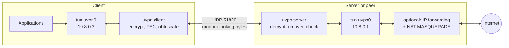
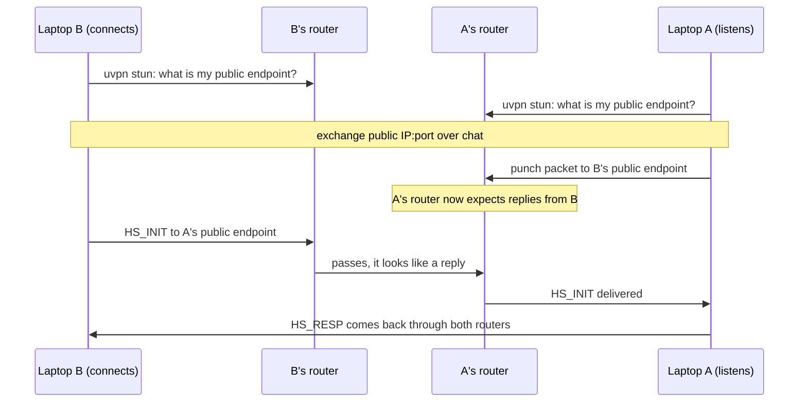

# Secure Userspace VPN (UVPN)

A VPN written from scratch in Python. It has its own tunnel protocol over UDP, its own authenticated key exchange, and it runs on real Linux machines over a real network. It works as a classic client–server VPN, or as a direct **peer-to-peer tunnel between two computers with no server in the middle**.

The client captures IP packets from a Linux **TUN** interface, encrypts them with **ChaCha20-Poly1305**, and sends them inside **UDP** datagrams to the other end. That end decrypts them, writes them into its own TUN interface, and (optionally) uses **NAT** to forward them to the Internet. Replies travel the same path in reverse.

The code is kept small on purpose, so that every step of tunnelling can be read and understood. On top of the core VPN it adds features that WireGuard and OpenVPN do not have, each one switchable and measurable:

| Feature | What it does | Flag |
|---|---|---|
| **Adaptive forward error correction** | Sends XOR parity packets so lost packets are rebuilt without a retransmission; redundancy follows the loss the peer reports | `--fec adaptive` |
| **Peer-to-peer mode with NAT hole punching** | Two computers behind home routers connect directly, no server; a built-in STUN client finds public endpoints and detects NAT type | `--peer`, `--local-port`, `uvpn stun` |
| **Traffic obfuscation** | Every header is masked and packets are padded, so no fixed bytes or exact sizes are visible to DPI | `--obfs` |
| **Roaming with path validation** | Follows a client to a new IP/port only after it answers a challenge there (as QUIC does), so an attacker cannot redirect the tunnel | always on |
| **Kill switch + IPv6 leak block** | Blocks every packet that is not tunnel traffic; stays in force if the client crashes | `--kill-switch` |
| **Live status** | Sessions, endpoints, loss in each direction, FEC block size, parity and recovery counters | `uvpn status` |

Author: Lakshya Saxena

---

## Contents

- [Results](#results)
- [How it works](#how-it-works)
- [Protocol](#protocol)
- [Requirements](#requirements)
- [Quick start: client and server](#quick-start-client-and-server)
- [Connecting two computers directly (no server)](#connecting-two-computers-directly-no-server)
- [Command reference](#command-reference)
- [Testing](#testing)
- [Project layout](#project-layout)
- [Security notes and limitations](#security-notes-and-limitations)
- [Roadmap](#roadmap)
- [License](#license)

---

## Results

`scripts/fec-bench.sh` drops a random share of tunnel packets in **each** direction, then pings through the tunnel and downloads 2 MB over HTTP (TCP) through it. Measured in the network-namespace lab:

| Loss each way | FEC | Ping loss | 2 MB download | Parity sent / packets rebuilt (server) |
|---|---|---|---|---|
| 0 % | off | 0 % | 0.08 s | 0 / 0 |
| 0 % | adaptive | 0 % | 0.08 s | 0 / 0 |
| 5 % | off | 8.5 % | 1.61 s | 0 / 0 |
| 5 % | adaptive | 0 % | 0.12 s | 420 / 59 |
| 10 % | off | 21 % | 8.50 s | 0 / 0 |
| 10 % | adaptive | 3 % | 0.12 s | 434 / 125 |
| 20 % | off | 34.5 % | timed out after 60 s | 0 / 0 |
| 20 % | adaptive | 6.5–7 % | 2.1–4.7 s | 644–838 / 222–230 |

With no loss, adaptive FEC sends no parity at all, so it costs nothing. At 10 % loss the download is about 70 times faster. TCP treats every lost packet as congestion and slows down, so its throughput falls roughly with 1/√loss (Mathis et al., 1997); rebuilding the packet at the tunnel hides the loss from TCP.

Other measured checks (all in `scripts/netns-test.sh`):

- Obfuscation: the first two header bytes of captured packets take **4** distinct values in clear (version + 4 message types) and **57** distinct values when obfuscated.
- Roaming: when the client's address changes, the server sends a `PATH_CHALLENGE` and switches to the new address only after the `PATH_RESPONSE`.
- Kill switch: after the server dies, direct traffic from the client is rejected; the rules disappear on a clean exit.

## How it works



1. An application sends a packet. The routing table points it at `uvpn0`.
2. The client reads the raw IP packet from the TUN device, pads it (with `--obfs`), seals it into a `DATA` message, and sends it over UDP. Every *k* packets it also sends one parity packet (with `--fec`).
3. The other side unmasks the header, finds the session by its ID, checks the replay window and decrypts. If a packet was lost and the parity covers it, the packet is rebuilt from the parity and checked the same way.
4. The inner source address must match the session's tunnel address (anti-spoofing). The packet is written into the TUN device; with `--nat` the kernel forwards it to the Internet.
5. Replies take the same path back.

Both sides run one single-threaded event loop (`selectors`, which uses `epoll` on Linux). It watches the TUN device, the UDP socket and the status socket, and runs timers every second (every 5 ms with FEC, to flush partial blocks).

## Protocol

### Header (16 bytes, network byte order)

| Field | Size | Purpose |
|---|---|---|
| Version | 1 byte | Protocol version, currently `1` |
| Type | 1 byte | Message type, see below |
| Flags | 2 bytes | Reserved, `0` |
| Session ID | 4 bytes | Chosen by the server; identifies the session |
| Sequence | 8 bytes | Per-direction counter; AEAD nonce and replay-window position. For `FEC`: first sequence of the block |

| Type | Message | Encrypted | Body |
|---|---|---|---|
| 1 | `HS_INIT` | no (HMAC) | client id, ephemeral public key, timestamp, MAC, optional padding |
| 2 | `HS_RESP` | no (HMAC) | ephemeral public key, tunnel IP, prefix, MTU, MAC, optional padding |
| 3 | `DATA` | yes | one inner IP packet (+ zero padding with `--obfs`) |
| 4 | `KEEPALIVE` | yes | loss this side measured, in ‰ (feeds the peer's FEC) |
| 5 | `CLOSE` | yes | empty |
| 6 | `FEC` | no (see below) | count, (type, length) per packet, XOR of their ciphertexts |
| 7 | `PATH_CHALLENGE` | yes | 8 random bytes |
| 8 | `PATH_RESPONSE` | yes | the same 8 bytes |

Encrypted messages carry a ChaCha20-Poly1305 ciphertext and 16-byte tag. The nonce is 4 zero bytes followed by the sequence number; the header is the associated data.

### Handshake

```text
Client                                                Server
  |  HS_INIT: client id, ephemeral pub Ec, timestamp,    |
  |           HMAC(psk, header || body)                  |
  | ---------------------------------------------------> |  check MAC, timestamp, replay cache
  |                                                      |  generate Es, pick session id + tunnel IP
  |  HS_RESP: session id, ephemeral pub Es, tunnel IP,   |
  |           prefix, MTU, HMAC(psk, ... || INIT mac)    |
  | <--------------------------------------------------- |
  |  both: shared = X25519(e, E)                         |
  |        c2s || s2c = HKDF-SHA256(salt=psk,            |
  |                       info="uvpn v1 session keys" || Ec || Es)
  |  KEEPALIVE (first encrypted packet, confirms keys)   |
  | ---------------------------------------------------> |
```

- The response's MAC covers the request's MAC, so a response only matches the one request it answers.
- An INIT is rejected if its timestamp is more than 120 s from the server's clock, or if the same INIT was seen before.
- Fresh ephemeral keys for every session give forward secrecy. The PSK is also the HKDF salt.

### Forward error correction

The sender puts every *k* consecutive transport packets into a block. When the block is full, or 5 ms after it started, it sends a `FEC` packet: the XOR of the blocks' ciphertexts, each zero-padded to the longest, plus each packet's type and length. If exactly one packet of the block is missing, the receiver XORs the parity with the packets it has and gets the missing ciphertext back. The rebuilt packet then goes through the normal replay check and AEAD check, so a forged parity packet can at worst produce a packet that fails authentication.

With `--fec adaptive`, each side counts gaps in the sequence numbers it receives and reports the loss in every keepalive (once a second). The sender picks *k* from the smoothed loss:

| Reported loss | < 0.5 % | < 2 % | < 5 % | < 10 % | < 20 % | < 25 % | ≥ 25 % |
|---|---|---|---|---|---|---|---|
| Block size *k* | no parity | 8 | 6 | 4 | 3 | 2 | 1 (every packet sent twice) |

*k* is capped at 8 so a parity packet stays under 1500 bytes at the default MTU. `--fec 4` fixes *k* instead.

### Obfuscation

With `--obfs` on both sides, the 16 header bytes of every packet are XORed with ChaCha20(*key*, nonce = the packet's last 16 bytes). The last 16 bytes are always a tag, MAC, padding or XORed ciphertext, so they differ per packet, and the receiver can rebuild the mask before parsing anything. *key* is derived from the PSK, so without it no byte of the packet is predictable. `DATA` packets are padded to multiples of 128 bytes, and handshakes and keepalives get random padding. This hides the protocol from fingerprinting; the security still comes from the AEAD.

### Path validation

When an authenticated packet arrives from a new address, the server keeps sending to the old one and sends a `PATH_CHALLENGE` with 8 random bytes to the new one (at most once a second per address). The client echoes them in a `PATH_RESPONSE`; only then does the server switch. This stops an attacker who replays a captured packet from a different address from redirecting the tunnel.

### Sizes and timers

| Item | Value |
|---|---|
| Per-packet overhead | 16 header + 16 tag + 28 outer IPv4/UDP = 60 bytes |
| Tunnel MTU | 1400 (leaves room on a 1500-byte path) |
| Keepalive interval | 10 s; 1 s with FEC (the server echoes each one) |
| Dead-peer timeout | 35 s, then the client reconnects |
| Rekey interval | 120 s; the previous key keeps working for packets in flight |
| Server session expiry | 60 s idle, or 180 s old |
| Replay window | 2048 packets |
| FEC flush delay | 5 ms |

## Requirements

- Linux with TUN support (`/dev/net/tun`), iproute2 and iptables. Tested on Ubuntu 22.04 (WSL2) and Debian 13 (trixie).
- Python 3.10 or newer, and the `cryptography` package.
- Root, or `CAP_NET_ADMIN`, to create the TUN device and change routes and firewall rules.

```bash
git clone https://github.com/lakshya076/userspace-vpn.git
cd userspace-vpn
python3 -m venv .venv
.venv/bin/pip install -r requirements.txt
```

On Ubuntu or Debian you can also use the system package: `sudo apt install python3-cryptography`.

### Windows users

Windows has no `/dev/net/tun`, so run UVPN inside **WSL2** (Ubuntu). WSL2's kernel includes TUN and netfilter. In WSL, `sudo` asks for your Linux password; `wsl -u root` opens a root shell without one.

- Only WSL's own traffic goes through the tunnel, not the Windows host's.
- By default WSL sits behind its own NAT, so it can **connect** but cannot **accept** connections. The listening side needs mirrored networking; see [step 2 of the two-computer guide](#step-2-let-laptop-a-accept-connections-laptop-a-only).
- The handshake needs clocks within 120 s; after a laptop sleeps, run `sudo hwclock -s` in WSL.
- The WSL kernel has no `tc netem`; the test scripts emulate loss with iptables instead.

## Quick start: client and server

### 1. Make a pre-shared key

```bash
umask 077
python3 -m uvpn genpsk > psk.key
```

Copy `psk.key` to the other machine over a secure channel (for example `scp`, or a private chat for a classroom demo). Never commit it to git.

### 2. Start the server

```bash
sudo .venv/bin/python -m uvpn server --psk-file psk.key --nat
```

This listens on UDP `0.0.0.0:51820`, creates `uvpn0` with `10.8.0.1/24`, and NATs tunnel traffic out of the default-route interface. Allow UDP 51820 in any firewall in front of the server; with ufw, for LAN clients only:

```bash
sudo ufw allow from 192.168.1.0/24 to any port 51820 proto udp comment uvpn
```

To keep it running after you log out:

```bash
sudo sh -c 'setsid nohup .venv/bin/python -m uvpn server --psk-file psk.key --nat > server.log 2>&1 < /dev/null &'
sudo pkill -TERM -f "uvpn server"   # stop it cleanly
```

### 3. Start the client

```bash
# reach only the tunnel network (10.8.0.0/24)
sudo python3 -m uvpn client --server 192.168.1.69:51820 --psk-file psk.key

# send all IPv4 traffic through the VPN, with loss protection and a kill switch
sudo python3 -m uvpn client --server 192.168.1.69:51820 --psk-file psk.key \
    --route-all --fec adaptive --kill-switch
```

`--fec` works per direction: give it to both sides to protect traffic both ways. `--obfs` must be given to both sides or neither.

### 4. Check it

```bash
ping 10.8.0.1                    # the server's tunnel address
sudo python3 -m uvpn status      # sessions, loss, FEC counters
ip route get 1.1.1.1             # with --route-all: "dev uvpn0"
curl https://ifconfig.me         # with --route-all: shows the server's public IP
sudo tcpdump -ni eth0 udp port 51820   # on the physical interface: only opaque UDP
sudo tcpdump -ni uvpn0                 # on the tunnel: readable inner packets
```

Stop either side with Ctrl+C (SIGINT) or SIGTERM. The client sends `CLOSE`, and both sides remove their routes and firewall rules. After a `kill -9` the kill switch stays in force on purpose; remove it by hand with `sudo iptables -D OUTPUT -j UVPN-KILLSWITCH; sudo iptables -F UVPN-KILLSWITCH; sudo iptables -X UVPN-KILLSWITCH` (and the same with `ip6tables`).

## Connecting two computers directly (no server)

"Server" and "client" are only roles: one computer **listens**, the other **connects**. Two laptops can therefore build a private tunnel between themselves with no third machine. Below, **laptop A** listens and **laptop B** connects. The steps assume both are Windows laptops running UVPN inside WSL2 (Ubuntu); on native Linux, skip the WSL parts.

Once the tunnel is up, laptop A is `10.8.0.1` and laptop B is `10.8.0.2`, whatever networks they are on. Anything that works over IP works between them: `ping`, `ssh`, `scp`, `python3 -m http.server`, a game server.

### Step 1: install (both laptops, in WSL)

```bash
sudo apt install python3-cryptography git
git clone https://github.com/lakshya076/userspace-vpn.git
cd userspace-vpn
```

### Step 2: let laptop A accept connections (laptop A only)

By default WSL sits behind its own NAT inside Windows, so it can connect out but cannot be reached. Laptop A needs **mirrored networking**, which gives WSL the same IP address as Windows (Windows 11 22H2 or newer). Laptop B can stay as it is.

1. Create or edit `C:\Users\<you>\.wslconfig`:

   ```ini
   [wsl2]
   networkingMode=mirrored
   ```

2. In PowerShell, run `wsl --shutdown`, then open WSL again.
3. In an **administrator** PowerShell, allow the VPN port through the firewalls. The first rule is for the Hyper-V firewall that sits in front of WSL; the second is for Windows Defender Firewall:

   ```powershell
   New-NetFirewallHyperVRule -Name UVPN -DisplayName "UVPN" -Direction Inbound -VMCreatorId '{40E0AC32-46A5-438A-A0B2-2B479E8F2E90}' -Protocol UDP -LocalPorts 51820
   New-NetFirewallRule -DisplayName "UVPN" -Direction Inbound -Protocol UDP -LocalPort 51820 -Action Allow
   ```

4. Make sure Windows treats the Wi-Fi as a **Private** network (Settings > Network & internet > Wi-Fi > the network's properties). On a Public network, Windows blocks inbound traffic.

### Step 3: share a key and fix the clocks (both)

Laptop A runs `python3 -m uvpn genpsk > psk.key` and sends the file to laptop B privately (a private chat is fine for a classroom demo). Both run `chmod 600 psk.key`.

The handshake rejects clocks that differ by more than 120 s, and the WSL clock can fall behind after a laptop sleeps. Before the demo, run `sudo hwclock -s` in WSL on both laptops to copy the Windows clock.

### Case A: same Wi-Fi, LAN or phone hotspot

This is the easiest setup for a demo. If the campus Wi-Fi blocks traffic between devices (many do), connect both laptops to one phone's hotspot.

1. Laptop A finds its address with `ip -4 addr` (for example `192.168.43.20`) and starts listening. Leave out `--nat`: laptop B's Internet traffic should not go through laptop A.

   ```bash
   sudo python3 -m uvpn server --psk-file psk.key
   ```

2. Laptop B connects:

   ```bash
   sudo python3 -m uvpn client --server 192.168.43.20:51820 --psk-file psk.key
   ```

3. Test from either side: `ping 10.8.0.1` on laptop B, `ping 10.8.0.2` on laptop A. Check `sudo python3 -m uvpn status` on either.

If laptop B keeps printing `HS_INIT sent` with no `tunnel up`, packets are not reaching laptop A. Re-check step 2: mirrored mode (`ip -4 addr` in WSL should show the same address as `ipconfig` in Windows), the two firewall rules, and the Private network setting.

To show off the extra features, add `--fec adaptive` and/or `--obfs` to **both** commands.

### Case B: different networks, over the Internet (UDP hole punching)

Home routers drop packets that arrive from outside unless something inside sent to that address first. So each side must open its own router for the other, at the same time. Both laptops should use mirrored networking here, so that WSL's own NAT does not add a second layer.



1. **Check your NAT (both).** Each runs the STUN check on the port it will use:

   ```bash
   python3 -m uvpn stun --port 51820   # laptop A
   python3 -m uvpn stun --port 51821   # laptop B
   ```

   It asks two public STUN servers what address they see. A good result looks like this:

   ```text
   stun.l.google.com:19302      sees you as 203.0.113.20:51820
   stun.cloudflare.com:3478     sees you as 203.0.113.20:51820

   Public endpoint: 203.0.113.20:51820  (local port 51820 kept)
   NAT mapping is endpoint-independent: hole punching should work.
   ```

   If it prints **symmetric NAT** instead, go to [When hole punching is not possible](#when-hole-punching-is-not-possible).

2. **Exchange the two "Public endpoint" lines** over chat.

3. **Laptop A starts first**, punching towards laptop B's public endpoint:

   ```bash
   sudo python3 -m uvpn server --psk-file psk.key --listen 0.0.0.0:51820 --peer 198.51.100.7:51821
   ```

4. **Laptop B connects** within a minute (NAT mappings expire), from the same local port it tested:

   ```bash
   sudo python3 -m uvpn client --psk-file psk.key --server 203.0.113.20:51820 --local-port 51821
   ```

5. Laptop B's log shows `tunnel up: 10.8.0.2/24`. Ping each other on `10.8.0.1` and `10.8.0.2`. Add `--fec adaptive` on both sides if the Wi-Fi is poor.

Laptop A keeps punching once a second until the handshake arrives, so it does not matter if laptop B is a little late. `scripts/p2p-test.sh` runs exactly this between two simulated home routers. It also checks the opposite case: without `--peer` the handshake never gets through.

### When hole punching is not possible

`uvpn stun` reports symmetric NAT when the router gives a different public port to every destination. Many mobile networks and ISPs that share one public IP between customers (CGNAT) work this way, as does the network this project was developed on. Then the other side cannot know which port to aim at. Options, easiest first:

- **Same network.** Put both laptops on one phone's hotspot and use Case A.
- **Port forwarding.** If laptop A's owner can log in to the router, forward UDP 51820 to laptop A. Then laptop A runs step 3 without `--peer`, and laptop B runs step 4 with laptop A's public IP. Only one side needs this.
- **An overlay network you already have.** If both laptops are on Tailscale or ZeroTier, use the other laptop's overlay address as `--server`. UVPN then runs its own encrypted tunnel inside it.
- **A relay.** Run the listening side on a machine with a reachable address (a VPS or a university server) with the client–server setup above. Traffic then goes through that machine.

## Command reference

```text
python3 -m uvpn [-v] genpsk
python3 -m uvpn [-v] server --psk-file FILE [--listen ADDR:PORT] [--subnet CIDR] [--mtu N]
                            [--tun NAME] [--nat] [--out-iface IFACE] [--peer IP:PORT ...]
                            [--fec off|adaptive|1-8] [--obfs]
python3 -m uvpn [-v] client --server HOST[:PORT] --psk-file FILE [--tun NAME] [--local-port N]
                            [--route-all] [--route CIDR ...] [--kill-switch]
                            [--fec off|adaptive|1-8] [--obfs]
python3 -m uvpn stun [--port N]
python3 -m uvpn status [--json]
```

| Option | Default | Meaning |
|---|---|---|
| `-v`, `--verbose` | off | Log every dropped packet and every system command |
| `--psk-file` | — | Base64 file with the 32-byte pre-shared key |
| `--tun` | `uvpn0` | TUN interface name |
| `--fec` | `off` | Forward error correction for packets this side sends: `adaptive`, or a fixed block size 1–8 |
| `--obfs` | off | Mask headers and pad packets; both sides must match |
| `--listen` | `0.0.0.0:51820` | Server: UDP address to listen on |
| `--subnet` | `10.8.0.0/24` | Server: tunnel subnet; the server takes the first address |
| `--mtu` | `1400` | Server: tunnel MTU, pushed to clients in the handshake |
| `--nat` | off | Server: enable forwarding and MASQUERADE to the Internet |
| `--out-iface` | default-route interface | Server: NAT egress interface |
| `--peer` | — | Server: punch a NAT hole towards this public endpoint (repeatable) |
| `--server` | — | Client: the other side's host and port (port defaults to 51820) |
| `--local-port` | random | Client: fixed local UDP port, needed for hole punching |
| `--route-all` | off | Client: route all IPv4 traffic into the tunnel |
| `--route` | — | Client: an extra network to route into the tunnel (repeatable) |
| `--kill-switch` | off | Client: reject all non-tunnel IPv4 traffic and all IPv6 |
| `stun --port` | `51820` | Local port to test |
| `status --json` | off | Raw status as JSON |

`uvpn status` (as root) reads `/run/uvpn/*.sock`, one socket per running instance. Example output:

```text
server on uvpn0  up 42 s  fec=adaptive  obfuscation=off  tunnel=10.8.0.1/24
  packets tx 1873 rx 2190  handshakes 1  fec recovered 125
  drops AuthError 3
  session 5e2c91a0  10.8.0.2 10.0.1.2:43112  age 41 s  loss in 9.8% out 10.3%  fec k=4 parity 434 recovered 125
```

## Testing

### Unit tests

```bash
python3 -m unittest -v
```

23 tests cover:
- the handshake round trip, wrong PSKs, stale and mismatched handshakes, and padded handshakes;
- a one-bit flip at every byte position of a data packet, replays, and the replay window's edge cases;
- FEC recovery of any single lost packet, two losses (not recoverable), forged parity (rejected by the AEAD check), the flush timer, the adaptive table and loss measurement;
- obfuscation round trips, random-looking headers and padding buckets;
- STUN response parsing.

### End-to-end tests with network namespaces

All scripts build virtual networks on one machine and need root (`wsl -u root` in WSL).

| Script | What it proves |
|---|---|
| `scripts/netns-test.sh` | Handshake; ping and HTTP through the tunnel and NAT; no plaintext on the wire; `status`; path validation on an address change; kill switch blocks leaks and is removed on exit; obfuscated headers look random; a client without `--obfs` is ignored by an obfuscated server |
| `scripts/p2p-test.sh` | Two peers behind separate NAT routers: no tunnel without punching, a working tunnel in both directions with it |
| `scripts/fec-bench.sh [loss% ...]` | The [Results](#results) table: ping loss and download time with FEC off and adaptive |

```text
[uvpn-cli] 10.0.1.2 ---- 10.0.1.1 [uvpn-srv] 198.51.100.1 ---- 198.51.100.2 [uvpn-net]
  client                   server + NAT                       "the Internet"

[uvpn-a] -- [uvpn-nat-a] 203.0.113.1 -- [uvpn-inet] -- 198.51.100.1 [uvpn-nat-b] -- [uvpn-b]
```

## Project layout

```text
uvpn/
  __main__.py     command line: genpsk, server, client, stun, status
  protocol.py     header, handshake, key derivation, AEAD session, replay window, loss accounting
  fec.py          XOR parity blocks, recovery, adaptive block size
  obfs.py         header masking and padding
  stun.py         STUN client for public endpoint and NAT type
  tun.py          TUN device (ioctl TUNSETIFF)
  netconf.py      addresses, routes, IP forwarding, NAT, kill switch, with undo
  loop.py         epoll event loop and status socket shared by client and server
  client.py       client: handshake, rekey, keepalive and loss reports, reconnect, path responses
  server.py       server: sessions, address pool, routing, anti-spoofing, path validation, hole punching
tests/            unit tests
scripts/          network-namespace labs: end-to-end, peer-to-peer, FEC benchmark
```

## Security notes and limitations

This is a teaching project. It has not been audited, so do not rely on it to protect sensitive traffic.

- **Pre-shared key.** All clients share one key. Anyone who holds it can join, and can pretend to be another client during a handshake. Per-client public keys are on the roadmap.
- **IPv4 only** inside and outside the tunnel. Without `--kill-switch`, IPv6 traffic bypasses the tunnel.
- **No DNS handling.** With `--route-all`, DNS goes wherever `/etc/resolv.conf` points. The kill switch always allows loopback, so a local DNS forwarder (as in WSL) still resolves outside the tunnel.
- **FEC costs bandwidth.** At high loss it can send every packet twice, and it adds up to 5 ms of delay before a partial block's parity goes out.
- **Clock sync.** The client's clock must be within 120 s of the server's.
- **Throughput** is limited by Python: one core does the event loop, encryption and FEC.
- **Reachability.** The listening side needs a UDP port the other side can reach: a LAN, a port forward, a hole punch, or an overlay. An SSH-only path such as a Cloudflare Tunnel does not carry UDP.
- **Fair use.** Run it only on networks and machines you are allowed to use.

## Roadmap

- Per-peer static keys with a Noise-IK handshake, DoS cookies, and a post-quantum hybrid key exchange
- TCP fallback transport for networks that block UDP, and a measured TCP-over-TCP comparison
- DNS through the tunnel, split tunnelling by domain, PMTU discovery
- Reed–Solomon codes to recover more than one loss per block
- A live web dashboard and a Wireshark dissector
- Benchmarks against WireGuard and OpenVPN on real networks

## License

[MIT](LICENSE) © 2026 Lakshya Saxena
