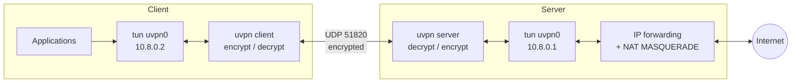

# Secure Userspace VPN (UVPN)

A point-to-point VPN written from scratch in Python. It has its own tunnel protocol over UDP, its own authenticated key exchange, and it runs on real Linux machines over a real network.

The client captures IP packets from a Linux **TUN** interface, encrypts them with **ChaCha20-Poly1305**, and sends them inside **UDP** datagrams to the server. The server decrypts them, writes them into its own TUN interface, and uses **NAT** to forward them to the Internet. Replies travel the same path in reverse.

The code is kept small on purpose, so that every step of tunnelling can be read and understood: packet capture, encapsulation, key exchange, encryption, replay protection, routing and NAT.

Author: Lakshya Saxena

---

## Contents

- [Features](#features)
- [How it works](#how-it-works)
- [Protocol](#protocol)
- [Requirements](#requirements)
- [Quick start](#quick-start)
- [Command reference](#command-reference)
- [Testing](#testing)
- [Project layout](#project-layout)
- [Security notes and limitations](#security-notes-and-limitations)
- [Roadmap](#roadmap)
- [License](#license)

---

## Features

- **TUN-based layer-3 tunnel.** Raw IPv4 packets are read from and written to `/dev/net/tun` (`IFF_TUN | IFF_NO_PI`), with non-blocking I/O.
- **Custom protocol over UDP.** A 16-byte header and five message types. UDP avoids the TCP-over-TCP problem.
- **Authenticated key exchange.** Ephemeral X25519 keys on both sides, authenticated with HMAC-SHA256 under a pre-shared key. Session keys come from HKDF-SHA256 and never cross the network. Fresh ephemeral keys for every session give forward secrecy.
- **Authenticated encryption.** Every data packet uses ChaCha20-Poly1305. The header is the associated data and the sequence number is the nonce, so changing any byte of the packet makes it fail.
- **Replay protection.** A 2048-packet sliding-window bitmap. It is updated only after a packet authenticates, so forged packets cannot move it. Handshake requests carry a timestamp and are cached, so they cannot be replayed either.
- **Session management.** Keepalives every 10 s, dead-peer detection, automatic reconnect, and rekeying every 120 s. After a rekey the previous key keeps working for packets still in flight.
- **Multiple clients.** The server hands out tunnel addresses from a pool and keeps each client's address across rekeys. It routes replies by tunnel address and drops any packet whose source address does not match the session that sent it (anti-spoofing).
- **Basic roaming.** If a client's IP or port changes (NAT rebinding, network switch), the server follows the newest authenticated packet.
- **Routing and NAT.** The client can route all IPv4 traffic through the tunnel while keeping a host route to the server. The server enables IP forwarding and adds `MASQUERADE` and `FORWARD` rules. Every system change is undone on exit.
- **Silent server.** Packets that fail authentication get no reply at all, so the server tells a scanner nothing.

## How it works



1. An application sends a packet. The client's routing table points it at `uvpn0`.
2. The client reads the raw IP packet from the TUN device, seals it into a `DATA` message, and sends it over UDP.
3. The server finds the session from the header's session ID, checks the replay window, decrypts, checks the inner source address, and writes the packet into its own TUN device.
4. The kernel forwards it; NAT rewrites the source address to the server's. Connection tracking matches the reply.
5. The reply reaches the server's `uvpn0`. The server looks up which client owns the destination tunnel address, encrypts, and sends the reply back over UDP.

Both sides run one single-threaded event loop (`selectors`, which uses `epoll` on Linux). It watches the TUN file descriptor and the UDP socket together and runs timers once a second.

## Protocol

### Header (16 bytes, network byte order)

| Field | Size | Purpose |
|---|---|---|
| Version | 1 byte | Protocol version, currently `1` |
| Type | 1 byte | `1` HS_INIT, `2` HS_RESP, `3` DATA, `4` KEEPALIVE, `5` CLOSE |
| Flags | 2 bytes | Reserved, `0` |
| Session ID | 4 bytes | Chosen by the server; identifies the session |
| Sequence | 8 bytes | Per-direction counter; AEAD nonce and replay-window position |

`DATA`, `KEEPALIVE` and `CLOSE` are followed by the ChaCha20-Poly1305 ciphertext and a 16-byte tag. The nonce is 4 zero bytes followed by the 8-byte sequence number. The 16-byte header is the associated data.

### Handshake

```text
Client                                                Server
  |  HS_INIT: client id, ephemeral pub Ec, timestamp,    |
  |           HMAC(psk, header || body)                  |
  | ---------------------------------------------------> |  check MAC, timestamp, replay cache
  |                                                      |  generate Es, pick session id + tunnel IP
  |  HS_RESP: session id, ephemeral pub Es, tunnel IP,   |
  |           prefix, MTU, HMAC(psk, ... || INIT mac)    |
  | <--------------------------------------------------- |
  |  both: shared = X25519(e, E)                         |
  |        c2s || s2c = HKDF-SHA256(salt=psk,            |
  |                       info="uvpn v1 session keys" || Ec || Es)
  |  KEEPALIVE (first encrypted packet, confirms keys)   |
  | ---------------------------------------------------> |
```

- The response's MAC covers the request's MAC, so a response only matches the one request it answers.
- An INIT is rejected if its timestamp is more than 120 s from the server's clock, or if the same INIT was seen before.
- The PSK is also the HKDF salt, so the session keys depend on both the Diffie-Hellman result and the PSK.

### Sizes and timers

| Item | Value |
|---|---|
| Per-packet overhead | 16 header + 16 tag + 28 outer IPv4/UDP = 60 bytes |
| Tunnel MTU | 1400 (leaves room on a 1500-byte path) |
| Keepalive interval | 10 s (the server echoes each one) |
| Dead-peer timeout | 35 s, then the client reconnects |
| Rekey interval | 120 s |
| Server session expiry | 60 s idle, or 180 s old |
| Replay window | 2048 packets |

## Requirements

- Linux with TUN support (`/dev/net/tun`), iproute2 and iptables. Tested on Ubuntu 22.04 (WSL2) and Debian 13 (trixie).
- Python 3.10 or newer.
- The `cryptography` package.
- Root, or `CAP_NET_ADMIN`, to create the TUN device and change routes and NAT.

```bash
python3 -m venv .venv
.venv/bin/pip install -r requirements.txt
```

On Ubuntu or Debian you can also use the system package: `sudo apt install python3-cryptography`.

### Windows users

Windows has no `/dev/net/tun`, so run UVPN inside **WSL2** (Ubuntu). WSL2's kernel includes TUN and netfilter. Two things to know:

- Only WSL's own traffic goes through the tunnel, not the Windows host's.
- WSL sits behind NAT, so it can act as a client but is not a good place for a server.

## Quick start

### 1. Make a pre-shared key

```bash
umask 077
python3 -m uvpn genpsk > psk.key
```

Copy `psk.key` to the client over a secure channel (for example `scp`). Never commit it to git.

### 2. Start the server

```bash
sudo .venv/bin/python -m uvpn server --psk-file psk.key --nat
```

This listens on UDP `0.0.0.0:51820` and creates `uvpn0` with `10.8.0.1/24`. `--nat` enables IP forwarding and NAT through the default-route interface. Allow UDP 51820 in any firewall in front of the server. With ufw, for LAN clients only:

```bash
sudo ufw allow from 192.168.1.0/24 to any port 51820 proto udp comment uvpn
```

### 3. Start the client

```bash
# reach only the tunnel network (10.8.0.0/24)
sudo python3 -m uvpn client --server 192.168.1.69:51820 --psk-file psk.key

# or send all IPv4 traffic through the VPN
sudo python3 -m uvpn client --server 192.168.1.69:51820 --psk-file psk.key --route-all
```

### 4. Check it

```bash
ping 10.8.0.1                    # the server's tunnel address
ip route get 1.1.1.1             # with --route-all: "dev uvpn0"
curl https://ifconfig.me         # with --route-all: shows the server's public IP
sudo tcpdump -ni eth0 udp port 51820   # on the physical interface: only opaque UDP
sudo tcpdump -ni uvpn0                 # on the tunnel: readable inner packets
```

Stop either side with Ctrl+C (SIGINT) or SIGTERM. The client sends `CLOSE`, and both sides remove their routes and NAT rules. A `kill -9` skips this cleanup; then remove the rules by hand with `iptables -D`.

### Running the server in the background

```bash
sudo sh -c 'setsid nohup .venv/bin/python -m uvpn server --psk-file psk.key --nat > server.log 2>&1 < /dev/null &'
sudo pkill -TERM -f "uvpn server"   # stop it cleanly
```

## Command reference

```text
python3 -m uvpn [-v] genpsk
python3 -m uvpn [-v] server --psk-file FILE [--listen ADDR:PORT] [--subnet CIDR]
                            [--mtu N] [--tun NAME] [--nat] [--out-iface IFACE]
python3 -m uvpn [-v] client --server HOST[:PORT] --psk-file FILE [--tun NAME]
                            [--route-all] [--route CIDR ...]
```

| Option | Default | Meaning |
|---|---|---|
| `-v`, `--verbose` | off | Log every dropped packet and every system command |
| `--listen` | `0.0.0.0:51820` | Server UDP address |
| `--subnet` | `10.8.0.0/24` | Tunnel subnet; the server takes the first address |
| `--mtu` | `1400` | Tunnel MTU, pushed to clients in the handshake |
| `--tun` | `uvpn0` | TUN interface name |
| `--nat` | off | Server: enable forwarding and MASQUERADE |
| `--out-iface` | default-route interface | Server: NAT egress interface |
| `--server` | — | Client: server host and port (port defaults to 51820) |
| `--route-all` | off | Client: route all IPv4 traffic into the tunnel |
| `--route` | — | Client: an extra network to route into the tunnel (repeatable) |

On exit each side logs its counters: packets and bytes sent and received, handshakes, and drops by reason (`drop_AuthError`, `drop_ReplayError`, `drop_spoofed`, ...).

## Testing

### Unit tests

```bash
python3 -m unittest -v
```

They cover the handshake round trip, a wrong PSK, stale and mismatched handshakes, a one-bit flip at **every** byte position of a data packet, replayed packets, and the replay window's edge cases.

### End-to-end test with network namespaces

```bash
sudo bash scripts/netns-test.sh
```

The script builds three namespaces on one machine:

```text
[uvpn-cli] 10.0.1.2 ---- 10.0.1.1 [uvpn-srv] 198.51.100.1 ---- 198.51.100.2 [uvpn-net]
  client                   server + NAT                       "the Internet"
```

It starts a real server and client and checks the handshake, a ping to the server's tunnel address, a ping and an HTTP request to the "Internet" host through the tunnel and NAT, and that a packet capture on the client–server link contains no plaintext. `uvpn-net` has no route back to the client, so reaching it proves NAT works. In WSL, run it as root with `wsl -u root`.

## Project layout

```text
uvpn/
  __main__.py     command line: genpsk, server, client
  protocol.py     header, handshake messages, key derivation, AEAD session, replay window
  tun.py          TUN device (ioctl TUNSETIFF)
  netconf.py      addresses, routes, IP forwarding, iptables NAT, with undo
  loop.py         epoll event loop shared by client and server
  client.py       client: handshake, rekey, keepalive, reconnect
  server.py       server: sessions, address pool, routing, anti-spoofing
tests/            unit tests
scripts/          netns end-to-end test
docs/             project plan and architecture
```

## Security notes and limitations

This is a teaching project. It has not been audited, so do not rely on it to protect sensitive traffic.

- **Pre-shared key.** All clients share one key. Anyone who holds it can join, and can pretend to be another client during a handshake. Per-client public keys are on the roadmap.
- **IPv4 only** inside and outside the tunnel. IPv6 traffic is not tunnelled and is not blocked, so it can leak around the tunnel.
- **No DNS handling.** With `--route-all`, DNS goes wherever `/etc/resolv.conf` points.
- **No kill switch.** If the tunnel drops, traffic falls back to the normal route.
- **Clock sync.** The client's clock must be within 120 s of the server's.
- **Throughput** is limited by Python: one core does the event loop and encryption.
- **Network reachability.** The server needs a UDP port the client can reach. An SSH-only path such as a Cloudflare Tunnel does not carry UDP.
- **Fair use.** Run it only on networks and machines you are allowed to use.

## Roadmap

[docs/PROJECT_PLAN.md](docs/PROJECT_PLAN.md) has the full architecture plan. Next steps include:

- Per-peer static keys with a Noise-IK handshake, DoS cookies, and a post-quantum hybrid key exchange
- Adaptive forward error correction for lossy Wi-Fi
- Seamless roaming with path validation
- Kill switch, DNS and IPv6 leak protection, split tunnelling, PMTU discovery
- Traffic obfuscation, measured against a DPI classifier
- A live dashboard and a Wireshark dissector
- Benchmarks against WireGuard and OpenVPN

## License

[MIT](LICENSE) © 2026 Lakshya Saxena
